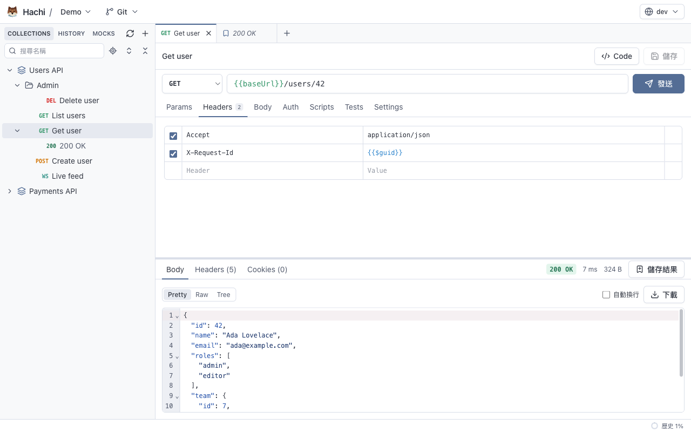

<p align="center">
  
</p>

<h1 align="center">Hachi</h1>

<p align="center">
  桌面版的 HTTP / WebSocket API 測試工具：請求以 JSON 檔存在你選的資料夾，直接用 git 管理。
</p>

<p align="center">
  <a href="https://github.com/CyclopesTsai/Hachi/releases">下載</a> ·
  <a href="README.md">English</a>
</p>



Hachi 的定位類似 Postman / Bruno：不需要帳號、不上雲、不用資料庫。**Workspace** 就是一個 JSON 檔案的資料夾（每個請求一個檔案），可以用 git 檢視差異、分享與版本控制。App 介面有繁體中文與英文，預設跟隨系統語言，也可以在 App 設定切換（原生選單為英文）。

## 功能

- **HTTP 請求**：Params、Headers、五種 Body（JSON、Raw、Form-data、x-www-form-urlencoded、none）、逾時、Proxy、重新導向、SSL 設定；回應可用 Pretty / Raw / JSON 樹狀 / HTML 預覽檢視
- **WebSocket**：Text / JSON / Binary 訊息、訊息範本、Ping 與心跳、可搜尋的訊息紀錄
- **變數**：環境、Collection 變數、不會進 git 的機密值、動態變數（`{{$guid}}`、`{{$timestamp}}`…）、讀取檔案內容的 `{{$file:base64:…}}`
- **驗證**：Bearer、Basic、API Key、OAuth 2.0、Digest、AWS Signature v4
- **腳本與測試**：在沙箱中執行的 JavaScript Pre-request / Post-response 腳本（支援 `await`、`sendRequest`，相容 Postman `pm.*` 與 Bruno `bru.*`），斷言表格、擷取變數
- **Collection Runner**：依次數或時間執行、並行、資料檔（CSV / JSON）、即時圖表與統計、HTML 報告
- **儲存結果**：把請求與回應存在請求底下，機密值與憑證會隱藏
- **Mock Server**：從 Workspace 提供固定內容的 HTTP 路由與 WebSocket 端點
- **Cookie Jar** 與 **TLS 憑證檢查**：憑證鏈診斷，以及 Mozilla、macOS / iOS、Windows 是否信任伺服器
- **匯入 / 匯出**：Postman、Bruno（`.bru` 與 YAML）雙向，匯入 cURL，匯出 OpenAPI 3.0（HTML / JSON），程式碼產生（cURL、fetch、axios、Python requests）
- **Git**：在 App 內 commit、Pull / Push、處理衝突、查看 History

## 下載

到 [Releases](https://github.com/CyclopesTsai/Hachi/releases) 下載最新版本：

| 平台                   | 檔案                                                                               |
| ---------------------- | ---------------------------------------------------------------------------------- |
| macOS（Apple Silicon） | `Hachi-x.y.z-arm64.dmg`                                                            |
| macOS（Intel）         | `Hachi-x.y.z-x64.dmg`                                                              |
| Windows（x64）         | `Hachi-x.y.z-setup-x64.exe`（安裝程式）或 `Hachi-x.y.z-portable-x64.exe`（免安裝） |

目前還沒有程式碼簽章：

- **macOS**：第一次開啟會被擋下。先打開一次，再到「**系統設定 → 隱私權與安全性**」按「**強制打開**」。
- **Windows**：出現「Windows 已保護您的電腦」時，按「**其他資訊 → 仍要執行**」。

Git 功能使用電腦上安裝的 git（Windows 請安裝 [Git for Windows](https://git-scm.com/download/win)）。

## 從原始碼建置

需求：Node.js 22.19+、npm。

```bash
npm install          # 同時下載 Electron 執行檔
npm run dev          # 開發模式
npm run verify       # 型別檢查、ESLint、Prettier、單元測試、授權檢查
npm run test:e2e     # 冒煙測試（會開啟 Hachi 視窗）
npm run dist:mac     # macOS .dmg（arm64 與 x64）
npm run dist:win     # Windows 安裝程式與免安裝版（在 Windows 上執行）
```

使用 Electron、React、TypeScript、Tailwind CSS 與 CodeMirror。Workspace 的檔案格式見 [docs/schema.md](docs/schema.md)。

## 授權

Copyright © 2026 Hachi contributors.

Hachi 是自由軟體，以 [GNU Affero General Public License v3.0 or later](LICENSE) 授權。貢獻需簽署 [CLA](CLA.md)，詳見 [CONTRIBUTING.md](CONTRIBUTING.md)。第三方授權見 [THIRD_PARTY_NOTICES.md](THIRD_PARTY_NOTICES.md)。
